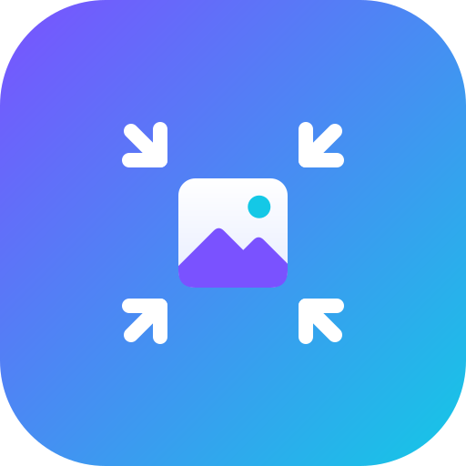
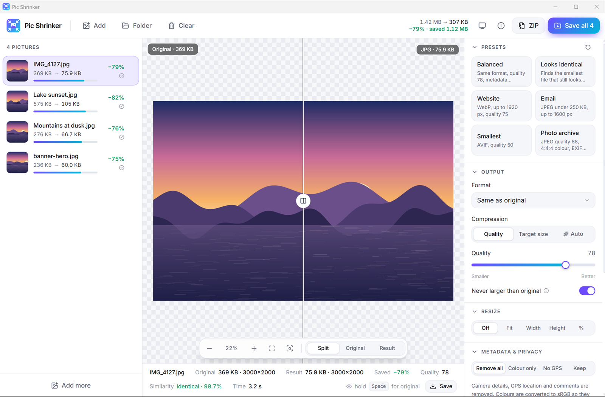

<div align="center">



# Pic Shrinker

**Fast, private image compression. Smaller pictures, same look.**

Created by **Uzair Asad**

[Website](https://uzairasad.github.io/pic-shrinker/) ·
[Open in your browser](https://uzairasad.github.io/pic-shrinker/app/) ·
[Download](https://github.com/uzairasad/pic-shrinker/releases/latest) ·
[Changelog](CHANGELOG.md)

[](LICENSE)
[](https://github.com/uzairasad/pic-shrinker/actions/workflows/ci.yml)

</div>



Pic Shrinker compresses JPEG, PNG, WebP, AVIF and HEIC pictures with the best encoders available
(MozJPEG, libwebp, libavif and OxiPNG) and shows you exactly what changed before you save. It
runs as a native app on Windows, macOS, Linux and Android, and in any modern browser. Every
picture is processed on your own device; nothing is uploaded.

## Features

- **Live before / after.** Drag a divider across the picture, zoom to 1600% with pixel-exact
  rendering, or hold <kbd>Space</kbd> to flip back to the original. Settings apply as you move
  them.
- **Three ways to compress.** A quality slider; a **target file size** (each picture gets the
  highest quality that fits); or **Auto**, which searches for the smallest file whose
  structural similarity (SSIM) to the original stays above "looks identical".
- **A quality score for every result**, so you can see when you've gone too far.
- **Modern formats.** Output JPEG, WebP, AVIF or lossless PNG. Read JPEG, PNG, WebP, AVIF,
  iPhone HEIC/HEIF, TIFF, BMP, GIF and JPEG XL.
- **Resize** to fit a box, a width, a height or a percentage, with Lanczos3, Magic Kernel
  Sharp, Mitchell, Catmull-Rom or bilinear resampling in linear light.
- **Metadata and privacy.** Remove everything, keep only the colour profile, keep EXIF *without
  the GPS location*, or keep it all. EXIF orientation is applied to the pixels, so pictures are
  always upright.
- **Expert JPEG controls.** Progressive, chroma subsampling (4:2:0 / 4:4:4), smoothing, nine
  quantization tables, extra trellis passes, grayscale, separate colour quality, background
  colour for transparency.
- **Never larger.** If an already-optimised picture would grow, the original is kept, with its
  metadata cleaned losslessly.
- **Batch.** Drop hundreds of pictures or whole folders (their structure is kept), or paste from
  the clipboard. Pictures compress in parallel on every CPU core and save into a folder you pick,
  never overwriting anything, or as one ZIP. Name patterns like `{name}-min` or `{name}-{w}px`.
- **Presets** for the common jobs: Balanced, Looks identical, Website, Email, Smallest and
  Photo archive.
- **Dark and light themes**, touch-friendly, works on phones.

## Download

Get the latest version from the [releases page](https://github.com/uzairasad/pic-shrinker/releases/latest).
Every file is listed with its SHA-256 checksum in `SHA256SUMS.txt`.

| Platform | File | Notes |
| --- | --- | --- |
| Windows 10/11 | `_x64-setup.exe`, `_x64_en-US.msi`, `-portable-windows-x64.zip` | If SmartScreen warns, choose More info → Run anyway. |
| macOS 10.15+ | `_aarch64.dmg` (Apple Silicon), `_x64.dmg` (Intel) | First launch: right-click the app → Open. |
| Linux | `.AppImage`, `.deb`, `.rpm` | Needs WebKitGTK 4.1 (Ubuntu 22.04+, Debian 12+, Fedora 37+). |
| Android | `-android-arm64.apk` | Signed release build for 64-bit phones and tablets. |
| Web | [Open in your browser](https://uzairasad.github.io/pic-shrinker/app/) | Install it as an app from the browser menu; it then works offline. |

The Windows and macOS builds aren't code-signed yet, which is why those warnings appear. See
[docs/SIGNING.md](docs/SIGNING.md).

Tip: on the desktop you can pass pictures or folders on the command line
(`pic-shrinker photo.jpg ~/Pictures/trip`), or drop them on the app's icon.

## How it's built

```
┌────────────────────────────────────────────────────────────────────┐
│  Interface — React + TypeScript (src/)                             │
│  batch list, before/after viewer, settings, presets                │
├────────────────────────────────────────────────────────────────────┤
│  Compression engine — Web Workers, one per CPU core (src/worker/)  │
│  decode → resize → encode → metadata → SSIM                        │
│  MozJPEG · libwebp · libavif · OxiPNG · libheif · libjxl (WASM)    │
├────────────────────────────────────────────────────────────────────┤
│  Platform bridge — src/platform/native.ts                          │
├───────────────────────────────────┬────────────────────────────────┤
│  Native shell — Rust, Tauri 2     │  Web — PWA with offline cache  │
│  (src-tauri/)                     │  File System Access API for    │
│  Save dialogs, write a batch into │  saving into a folder, ZIP     │
│  a folder without overwriting,    │  download elsewhere            │
│  reveal in file manager, open     │                                │
│  pictures from the command line   │                                │
├───────────────────────────────────┴────────────────────────────────┤
│  System web engine: WebView2 · WKWebView · WebKitGTK · Android     │
└────────────────────────────────────────────────────────────────────┘
```

- **One engine everywhere.** The codecs are compiled to WebAssembly, so the desktop apps, the
  Android app and the web app produce byte-identical files.
- **Quality search.** Target-size mode binary-searches the encoder quality (on a full-resolution
  sample of a large picture first, then confirms on the whole picture). Auto mode searches for
  the lowest quality whose SSIM stays above the threshold.
- **Very large JPEGs.** Scanned maps, panoramas and aerial photos of hundreds of megapixels
  (over 64 MP) never sit in memory whole: a streaming decoder (`src/lib/jpeg-stream.ts`) reads
  them a band at a time, resizing on the fly if asked, MozJPEG encodes each band, and
  `src/lib/jpeg-join.ts` joins the bands into one baseline JPEG with optimal Huffman tables.
  A 20000×14000 map uses a couple of hundred megabytes instead of several gigabytes.
- **Lossless metadata editing.** EXIF and ICC segments are copied from the original JPEG,
  cleaned (orientation reset, pixel size updated, GPS directory removed and zeroed) and written
  into the new file, in `src/lib/metadata.ts`.
- **Small, safe native apps.** The Rust shell uses the web engine the system already has. The
  webview has no general file-system access: it can only write into a folder you picked in a
  dialog, and only read pictures you opened.

### Repository layout

```
src/                  the app (React + TypeScript)
  components/         viewer, settings panel, file list, about box
  lib/                settings, naming, metadata (EXIF/ICC), SSIM, worker pool — with tests
  worker/             the compression engine (decode, resize, encode, quality search)
  platform/native.ts  bridge to the native shell
src-tauri/            Rust shell (Tauri 2): src/lib.rs, tauri.conf.json, icons
public/               web app icons
site/                 GitHub Pages project page
docs/                 SIGNING.md: release signing
LICENSE               GPL-3.0 text; THIRD-PARTY-NOTICES.md lists codecs and libraries
.github/workflows/    ci.yml, release.yml, pages.yml
```

## Develop

You need Node 22+, Rust (stable, via [rustup](https://rustup.rs)), and the
[Tauri prerequisites](https://tauri.app/start/prerequisites/) for your OS. On Windows that means
the "Desktop development with C++" build tools; WebView2 already comes with Windows 10/11.

```bash
npm install
npm run app:dev      # native app with hot reload
npm run app:build    # installers in target/release/bundle/
npm run dev          # web app only, http://localhost:3000
npm run build        # web app (dist/)
npm run lint         # TypeScript type check
npm test             # unit tests (metadata, naming, SSIM)
```

Rust checks: `cargo fmt --all`, `cargo clippy --workspace --all-targets -- -D warnings`,
`cargo test --workspace`.

## Releasing

1. Set the new version in `package.json` (the installers read it from there) and in
   `Cargo.toml` under `[workspace.package]`, and add it to `CHANGELOG.md`.
2. Commit, then tag and push, for example `git tag v0.2.0 && git push origin main v0.2.0`.
3. `.github/workflows/release.yml` builds every platform on GitHub Actions, signs the Android
   app, attaches `SHA256SUMS.txt` and publishes the release. The website's download buttons pick
   up the new files automatically.

Pushing to `main` also rebuilds the website and the web app (`.github/workflows/pages.yml`).

## License

Pic Shrinker is created by **Uzair Asad** and is free and open-source software, licensed under
the [GNU General Public License v3.0 or later](LICENSE). You can use it for anything, including
commercial work, study and change the source, and share it. Any version you distribute, changed
or not, must stay under the same license, with its source available and its credits kept.
Pictures you compress with the app are entirely yours.

The codecs and libraries are under their own licenses: see
[THIRD-PARTY-NOTICES.md](THIRD-PARTY-NOTICES.md).

© 2026 Uzair Asad
